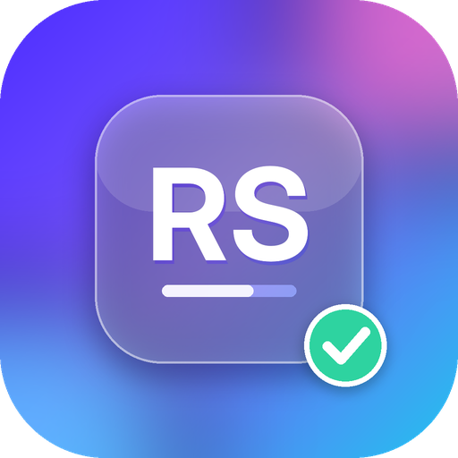

# RS Stock

**Controle de validades e estoque** — minimalista, intuitivo, com visual de vidro fosco (glassmorphism), tema escuro e claro.
Desenvolvido por **FlowLabs Studio**.

## Recursos

- **Contas na nuvem (Supabase)**: criar conta com nick + e-mail, entrar por nick ou e-mail, recuperar/alterar senha,
  alterar nick/e-mail, modo convidado offline. Ao entrar, os dados do convidado podem ser enviados para a conta.
- **Backup na nuvem**: tudo salva no aparelho na hora e sincroniza em segundo plano (funciona sem internet e envia depois).
- **Atualizações pelo RS Admin**: ao abrir, o app confere a última versão publicada. Obrigatória = tela bloqueante com
  “Atualizar agora”; opcional = aviso. O APK é baixado e o instalador do Android abre.

- **Várias lojas**: crie, edite e exclua lojas (ex.: Mercado Rio Sul, Guanabara). Cada loja tem o próprio estoque;
  troque de loja pelo topo da tela inicial ou de Produtos.
- **Cores por prazo**: ⚫ vencido (tag VENCIDO) · 🔴 menos de 7 dias · 🟡 7 a 30 dias · 🟢 mais de 30 dias.
- **Dar baixa / Entrada** com motivo (venda, vencido/descarte, avaria, uso interno, troca, ajuste) e observação.
- **Histórico completo**: cadastros, edições, baixas, entradas, remoções e ações de loja, por loja ou de todas, com autor e horário.
- **Exportação com o nome da loja** (ou de todas as lojas): PDF, imagem em **folhas** 1080×1920 (Folha 1, Folha 2…), texto e planilha.
- **Tema especial Coca**: vermelho e branco, bolhas, faixa ondulada, transições próprias e **ícone do app vermelho**.

- **Cara de app de verdade**: tela cheia imersiva (sem barras do sistema; pode desligar em Aparência), splash nativa com o ícone,
  cada aba cabe inteira na tela (sem rolar a página; só listas longas rolam por dentro), transições deslizantes entre abas e telas,
  efeito de toque (ripple), barra inferior flutuante com indicador animado, vibração, modo compacto automático em telas pequenas.
- **Introdução** em 3 telas deslizáveis na primeira abertura.
- **Calendário de validades** e faixa “Próximos 7 dias” na tela inicial.
- **Seleção múltipla** (segure um produto) para excluir vários de uma vez, com “Desfazer”.
- **Filtros** por status, data e categoria.
- **Histórico** de movimentações (adicionado, editado, entrada, baixa, removido).
- **Exportar em 4 formatos**: PDF, Imagem, Texto e Planilha (CSV para Excel/Google Planilhas).

- **Splash** com nome do app, carregamento minimalista e rodapé “FlowLabs Studio · Todos os direitos reservados”.
- **Login**: entrar com nick/e-mail e senha, criar conta com e-mail (preparados para Supabase, marcados “Em breve”),
  **entrar como convidado** (funcional) e botão **Visitar site** (em breve).
- **Início**: saúde do estoque (anel %), contadores (vencidos, hoje, próximos, em dia), ações rápidas e alertas.
- **Produtos**: busca, filtros por status, ordenação, detalhes, editar, duplicar, ajustar quantidade, excluir com “Desfazer”.
- **Cadastro rápido**: só nome e validade são obrigatórios; código de barras opcional (digitado ou **escaneado pela câmera**),
  atalhos de data (+7 dias, +1 mês…), quantidade/unidade, categoria, lote, local e observações; “Salvar e novo”.
  Se o código já existir, o app oferece reaproveitar nome/categoria.
- **Notificações**: resumo diário no horário escolhido com os produtos que vencem dentro de N dias (1–30) e os vencidos;
  reagenda após reiniciar o aparelho; botão de teste.
- **Ajustes**: Perfil, Aparência (tema escuro/claro/sistema, 6 cores, intensidade do vidro, fundo animado/estático/liso,
  lista compacta, vibração), Notificações, Acessibilidade (tamanho do texto, negrito, alto contraste, botões maiores,
  reduzir movimento, reduzir transparência), Segurança (PIN de 4 dígitos, bloquear ao voltar, senha da conta — em breve),
  Backup/restauração (.json), Créditos e Sobre.

## Arquitetura

App Android **sem dependências externas** (compatível com AIDE e Android Studio).

| Camada | Onde | Função |
|---|---|---|
| Interface | `app/src/main/assets/www` | HTML/CSS/JS servido em origem segura `https://appassets.androidplatform.net` |
| Ponte | `WebBridge.java` | `window.AndroidBridge`: sincronização, notificações, PDF, compartilhar/salvar, vibração |
| Alertas | `AlertScheduler`, `ExpiryReceiver`, `Notifier` | Alarme diário + boot, cálculo e notificação |
| PDF | `PdfExporter.java` | `android.graphics.pdf.PdfDocument` |
| Arquivos | `ShareProvider.java` | ContentProvider mínimo para compartilhar exportações |

Pastas JS: `config.js` (configuração), `services/` (native, storage, auth, scanner, exporter), `screens/` (telas), `app.js` (rotas e hotbar).

## Supabase (futuro)

1. Crie o projeto e rode `docs/supabase-schema.sql`.
2. Preencha `VS.config.supabase.url` / `anonKey` e ative `features.accounts` e `features.cloudSync` em `js/config.js`.
3. Implemente os trechos comentados em `js/services/auth.js` e o `SupabaseRepository` em `js/services/storage.js`
   (mesma interface do `LocalRepository`).

Para o site: preencha `siteUrl` e `features.site`.

## Compilar

- **AIDE**: extraia `RSStock.zip`, abra a pasta `RSStock` e rode.
- **Android Studio**: abra a pasta; compileSdk 29, minSdk 21 (Android 5.0+).

Para testar a interface no navegador: `cd app/src/main/assets/www && python3 -m http.server` e abra `http://localhost:8000`.

© FlowLabs Studio · Todos os direitos reservados.

Pacote: `com.flowlabs.rsstockw` · Ícones em `res/mipmap-*` (inclui ícone adaptativo Android 8+).

## Contas (v1.2.0)
- Cadastro e login **só com nick e senha** (função `signup` no servidor cria a conta já confirmada, com e-mail interno
  `@nick.rsstock.app`). Contas antigas com e-mail continuam entrando pelo nick.
- **Continuar com Google**: abre o navegador e volta pelo link `rsstock://login-callback`.
  Para funcionar, ative no Supabase: Authentication › Providers › **Google** (Client ID e Secret do Google Cloud)
  e em Authentication › URL Configuration › **Redirect URLs** adicione `rsstock://login-callback`.

## Tema Coca 2.0
- Garrafa enchendo o copo com gelo no fundo, transição “derramando” entre abas, itens caindo como gelo,
  cartão principal enchendo de refrigerante, formatos efervescendo, botão + tampinha. O tema Coca original não mudou.

## Compatibilidade (v1.3.0) — Ajustes › Compatibilidade
- Detecta o aparelho (celular pequeno, celular, tablet) e adapta: **Compacto**, **Celular** ou **Tablet**
  (conteúdo centralizado e listas em 2 colunas). Pode escolher manualmente.
- **Tamanho da interface** (85% a 115%), **orientação** (automática, retrato, paisagem — tablet gira sozinho).
- **Modo leve** (sem desfoque/efeitos de fundo), **Sem transições** e **Aceleração GPU** liga/desliga para
  aparelhos que piscam ou travam. Aparelhos mais simples ligam o modo leve automaticamente na primeira abertura.

## Estabilidade (v1.3.1)
- Corrigido fechamento ao abrir: a troca de ícone do tema Coca agora só acontece com o app fora da tela e o ícone
  atual é lido do próprio Android (antes podia entrar em ciclo de abre-e-fecha).
- Se o motor do WebView parar, a tela é recriada em vez de fechar o app.
- Fechou logo após abrir? O app volta em **modo seguro** e mostra o relatório do erro com o botão **Copiar**.

## v1.3.2 — correção definitiva do "não abre"
- O ícone do app **não troca mais sozinho** ao escolher o tema Coca/Coca 2.0 (era o que fazia o Android fechar o app
  em ciclo). Agora é um botão opcional em Aparência e a troca só acontece com o app fora da tela.
- Resgate na abertura: se travar por 12 s, aparece “Abrir em modo seguro” (tema padrão, sem efeitos pesados).
- Depois de um fechamento, o app reabre com o tema padrão e em modo seguro.

## v1.4.0
- Tema Coca 2.0 removido (fica só o Coca). Quem estava no Coca 2.0 passa para o Coca.
- Compatibilidade refeita: botão **Modo compatibilidade de dispositivo** (qualquer Android 5.0+ até o mais recente,
  qualquer tela e DPI): sem efeitos pesados, barras do sistema visíveis, escala pela largura da tela, cores simples.
  Opções detalhadas em “Avançado”.
- Versão exibida na abertura e no login.

## v2.1.0 — equipe, ronda, perdas, widget
- **Widget "Validades"** na tela inicial do Android (segure a tela › Widgets › RS Stock): contagem por cor da loja aberta e os 3 próximos a vencer. Atualiza a cada mudança e todo dia.
- **Resumo semanal automático** por notificação (dia e hora em Ajustes › Notificações): vencidos, o que vence em 7 dias, perdas em R$ e rondas pendentes.
- **Ronda semanal de validade** (Início › Ronda): conferir / ajustar / descartar cada produto, progresso, conclusão registrada no histórico.
- **Relatório de perdas** (Início › Perdas): baixas por "Vencido" e "Avaria" em R$ (campo *Custo unitário* no produto), por motivo, semana, produto e loja; compartilhar em texto.
- **Exportar / importar loja** (Minhas lojas › ⚙ › Exportar; ⬇ Importar): arquivo `Loja-<nome>.rsstock.json` com todos os produtos.
- **Loja online compartilhada / equipe** (Minhas lojas › Equipe): código de convite, entrar com código (🔑), papéis dono/editor/visualizador, sincronização ao vivo (Supabase Realtime).
- Servidor: aplicar `docs/migrations/002_equipe_rondas_perdas.sql` (SQL Editor do Supabase). Sem ela o app continua sincronizando, mas equipe/rondas na nuvem ficam desativadas.

## v2.2.0 — várias datas por produto e alertas que tocam
- **Mesmo produto com várias validades**: no cadastro, "+ Adicionar outra data" (ex.: Leite Tirol 1L — 12 un vencem dia 10, 30 un no mês que vem). A lista mostra um card por produto com as datas; o detalhe lista cada data com sua quantidade, baixa e descarte por data, e "+ Nova data". Baixa pergunta de qual data (a mais antiga primeiro).
- **Notificações por mercado**: "🏪 Mercado Rio Sul: Leite Tirol 1L vence amanhã", com quantidade e data; som de **alarme** (volume do despertador), notificação ou silencioso; vibração forte; opção "Tocar até eu abrir". Alarmes exatos (tocam na hora marcada).
- Folhas e diálogos quase opacos, fundo escurecido e fosco atrás, e troca de telas sem uma "vazar" por cima da outra.
