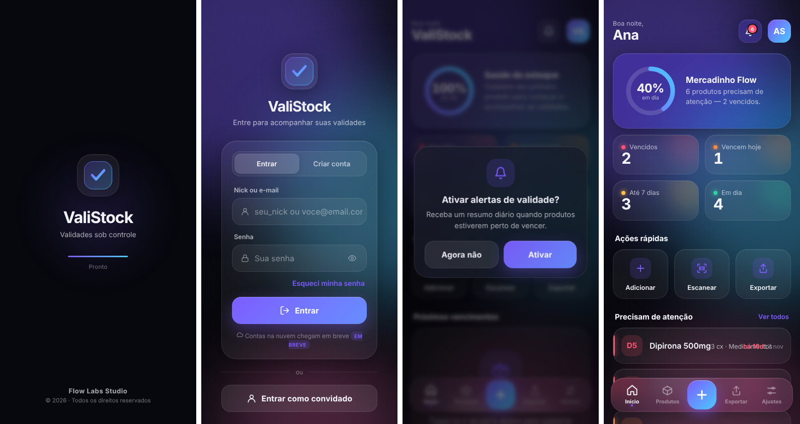

# ValiStock

**Controle de validades e estoque** — minimalista, intuitivo, com visual de vidro fosco (glassmorphism), tema escuro e claro.
Desenvolvido por **Flow Labs Studio**.

## Recursos

- **Splash** com nome do app, carregamento minimalista e rodapé “Flow Labs Studio · Todos os direitos reservados”.
- **Login**: entrar com nick/e-mail e senha, criar conta com e-mail (preparados para Supabase, marcados “Em breve”),
  **entrar como convidado** (funcional) e botão **Visitar site** (em breve).
- **Início**: saúde do estoque (anel %), contadores (vencidos, hoje, próximos, em dia), ações rápidas e alertas.
- **Produtos**: busca, filtros por status, ordenação, detalhes, editar, duplicar, ajustar quantidade, excluir com “Desfazer”.
- **Cadastro rápido**: só nome e validade são obrigatórios; código de barras opcional (digitado ou **escaneado pela câmera**),
  atalhos de data (+7 dias, +1 mês…), quantidade/unidade, categoria, lote, local e observações; “Salvar e novo”.
  Se o código já existir, o app oferece reaproveitar nome/categoria.
- **Notificações**: resumo diário no horário escolhido com os produtos que vencem dentro de N dias (1–30) e os vencidos;
  reagenda após reiniciar o aparelho; botão de teste.
- **Exportar**: **PDF** (A4, gerado nativamente), **Imagem** (PNG com todos os produtos, dividido a cada 40) e **Texto**
  (pronto para WhatsApp). Filtros, ordenação e campos opcionais. Compartilhar ou salvar.
- **Ajustes**: Perfil, Aparência (tema escuro/claro/sistema, 6 cores, intensidade do vidro, fundo animado/estático/liso,
  lista compacta, vibração), Notificações, Acessibilidade (tamanho do texto, negrito, alto contraste, botões maiores,
  reduzir movimento, reduzir transparência), Segurança (PIN de 4 dígitos, bloquear ao voltar, senha da conta — em breve),
  Backup/restauração (.json), Créditos e Sobre.

## Arquitetura

App Android **sem dependências externas** (compatível com AIDE e Android Studio).

| Camada | Onde | Função |
|---|---|---|
| Interface | `app/src/main/assets/www` | HTML/CSS/JS servido em origem segura `https://appassets.androidplatform.net` |
| Ponte | `WebBridge.java` | `window.AndroidBridge`: sincronização, notificações, PDF, compartilhar/salvar, vibração |
| Alertas | `AlertScheduler`, `ExpiryReceiver`, `Notifier` | Alarme diário + boot, cálculo e notificação |
| PDF | `PdfExporter.java` | `android.graphics.pdf.PdfDocument` |
| Arquivos | `ShareProvider.java` | ContentProvider mínimo para compartilhar exportações |

Pastas JS: `config.js` (configuração), `services/` (native, storage, auth, scanner, exporter), `screens/` (telas), `app.js` (rotas e hotbar).

## Supabase (futuro)

1. Crie o projeto e rode `docs/supabase-schema.sql`.
2. Preencha `VS.config.supabase.url` / `anonKey` e ative `features.accounts` e `features.cloudSync` em `js/config.js`.
3. Implemente os trechos comentados em `js/services/auth.js` e o `SupabaseRepository` em `js/services/storage.js`
   (mesma interface do `LocalRepository`).

Para o site: preencha `siteUrl` e `features.site`.

## Compilar

- **AIDE**: abra a pasta `ValiStock` e rode.
- **Android Studio**: abra a pasta; compileSdk 29, minSdk 21 (Android 5.0+).

Para testar a interface no navegador: `cd app/src/main/assets/www && python3 -m http.server` e abra `http://localhost:8000`.

© Flow Labs Studio · Todos os direitos reservados.
